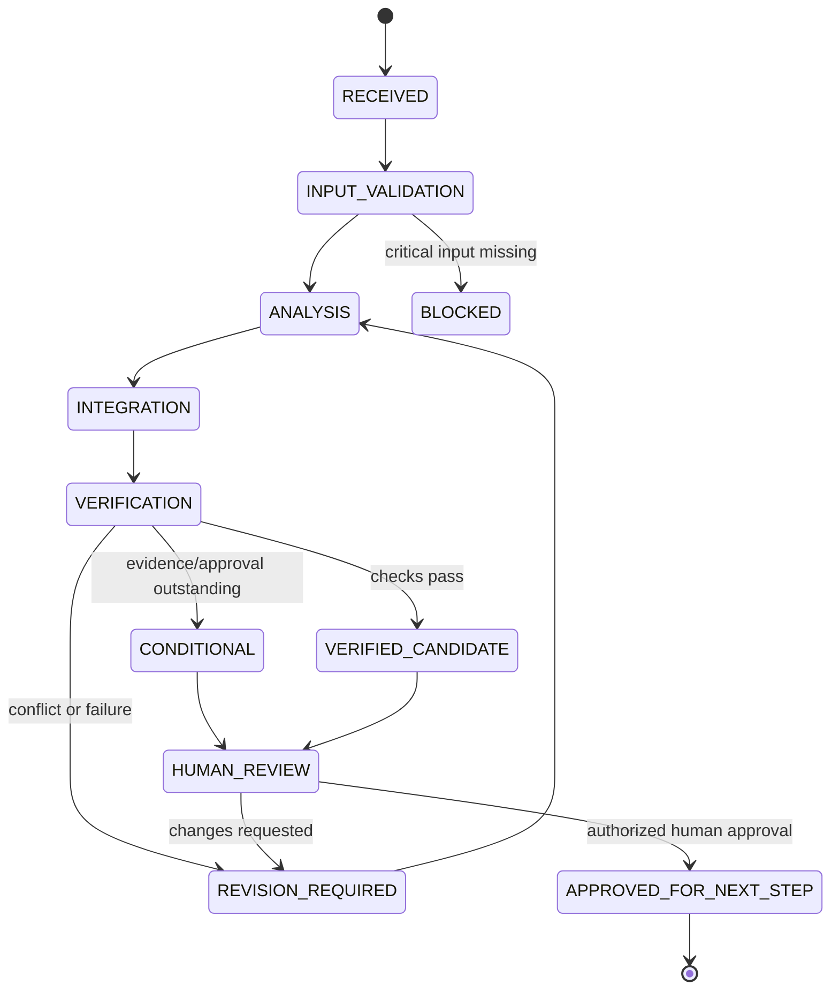

# Workflow and State Machine

## 1. Logical workflow

1. Receive design package and production constraints.
2. Validate package identity, revision, units, and completeness.
3. DFM evaluates design and raises questions.
4. Process Engineering proposes process routes.
5. Materials & Tooling evaluates materials and tooling.
6. Supplier Assessment evaluates sourcing feasibility.
7. Capacity Planning estimates facility fit and schedule.
8. Cost & Yield estimates economics and yield.
9. QA proposes inspection and control requirements.
10. Manufacturing Risk evaluates failure and disruption scenarios.
11. Production Readiness checks launch prerequisites.
12. Verification evaluates the complete plan.
13. Human reviewers disposition findings and authorize any controlled release.

Some tasks may run in parallel when dependencies are satisfied. Any upstream change invalidates affected downstream results and triggers re-evaluation.

## 2. Plan lifecycle

`APPROVED_FOR_NEXT_STEP` means only that the designated authority approved the next defined workflow step. It does not automatically mean authorization to manufacture.

## 3. Change propagation

Each result records the exact upstream revisions on which it depends. If a design, BOM, supplier, process, or facility input changes, dependent outputs become `STALE` until re-run and re-verified.

## 4. Conflict record

A conflict record should contain:
- conflict ID;
- affected requirement or decision;
- competing values/claims;
- source references and revisions;
- hard/soft classification;
- severity and downstream impact;
- proposed options;
- accountable decision owner;
- resolution, rationale, and timestamp.
